# 大學生零基礎健身通關指南 9 頁簡報知識沉澱與論述結構

## 💡 核心定位
本頁為本專案的核心產出——9 頁全螢幕熱血 HTML 幻燈片（見 [[index.html]]）的知識沈澱。將每一頁的簡報內容與底層的運動科學 Wiki 頁面進行完整雙向錨定，供講者口頭演講、課堂報告與未來延伸修訂時參考。

---

## 🧭 9 頁投影片與 Wiki 雙向連結對照表

```mermaid
graph TD
    Slide1["Slide 1: 封面起步"] --> Ref1["woman-tying-shoelaces...jpg"]
    Slide2["Slide 2: 破冰動機"] --> ConceptBDNF["BDNF神經效益 & 新手紅利"]
    Slide3["Slide 3: 重訓4大模式"] --> WikiTrain["[[wiki/training/four-movement-patterns.md]]"]
    Slide4["Slide 4: 胸推熱身SOP"] --> WikiWarmup["[[wiki/training/warmup-sop.md]]"]
    Slide5["Slide 5: Zone 2有氧"] --> WikiCardio["[[wiki/concepts/zone-2-cardio.md]]"]
    Slide6["Slide 6: 超商蛋白質"] --> WikiProt["[[wiki/nutrition/protein-basics-and-sources.md]]"]
    Slide7["Slide 7: 科學減脂CICO"] --> WikiFat["[[wiki/fat-loss/fat-loss-myths.md]]"]
    Slide8["Slide 8: 一週3天課表"] --> WikiProg["[[wiki/programming/student-3day-split.md]]"]
    Slide9["Slide 9: 結語與行動"] --> CheckList["3步落地行動 Check-list"]
```

### 1. Slide 1 封面：啟動新手紅利期
* **核心意念**：跨出第一步最難，但回報最高。
* **本地素材**：`./woman-tying-shoelaces-preparing-workout.jpg`

### 2. Slide 2 新手破冰：打破三大藉口
* **核心意念**：沒時間、沒錢、怕被看。
* **科學支撐**：運動提升大腦神經可塑性 (BDNF)，讀書效率加倍；學校體育館銅板價；享受新手增肌減脂雙贏期。

### 3. Slide 3 重訓入門：四大動作模式
* **關聯頁面**：[[wiki/training/four-movement-patterns.md]]
* **本地素材**：`./fitness-girl-lifting-weights-sunny-gym.jpg`
* **論述核心**：推、拉、蹲、鉸鏈；前兩個月首推機械式。

### 4. Slide 4 動作防護：胸推前熱身 4 步驟 SOP
* **關聯頁面**：[[wiki/training/warmup-sop.md]]
* **本地素材**：`./1692783802.6486.png`（Heho 圖解）
* **論述核心**：輕度有氧 ➔ 滾筒放鬆中上背 ➔ 動態伸展 ➔ 啟動穩定肌。

### 5. Slide 5 有氧心肺：Zone 2 低強度有氧秘密
* **關聯頁面**：[[wiki/concepts/zone-2-cardio.md]]
* **本地素材**：`./serene-yoga-practice-sunny-room.jpg`
* **論述核心**：脂肪氧化最佳區間；說話檢測法（能講話、不能唱歌）；課後伸展與主動恢復。

### 6. Slide 6 蛋白質與外食：超商生存攻略
* **關聯頁面**：[[wiki/nutrition/protein-basics-and-sources.md]]
* **文獻支撐**：[[raw/issn-protein-exercise-position-stand.md]]
* **論述核心**：每日體重 × 1.2～1.6g；無糖豆漿 ＋ 茶葉蛋 ＋ 舒肥雞；乳清補劑迷思破解。

### 7. Slide 7 科學減脂：熱量赤字與破除迷思
* **關聯頁面**：[[wiki/fat-loss/fat-loss-myths.md]] ＆ [[wiki/concepts/cico-energy-balance.md]]
* **論述核心**：CICO 熱量守恆定律；打臉穿雨衣暴汗、不吃晚餐、局部瘦小腹三大迷思。

### 8. Slide 8 實戰課表：每週 3 天極簡排程
* **關聯頁面**：[[wiki/programming/student-3day-split.md]]
* **本地素材**：`./istockphoto-638721864-1024x1024.jpg`
* **論述核心**：週一推蹲、週三心肺、週五拉鉸鏈；期中期末考週降為 1 次維持即可。

### 9. Slide 9 結語與行動：踏出宿舍第一步！
* **論述核心**：明天早餐買豆漿茶葉蛋、這週挑一天操場快走 30 分鐘、揪室友參觀健身房。
* **金句結語**：*「最好的課表，就是你能持之以恆的那一套！」*
